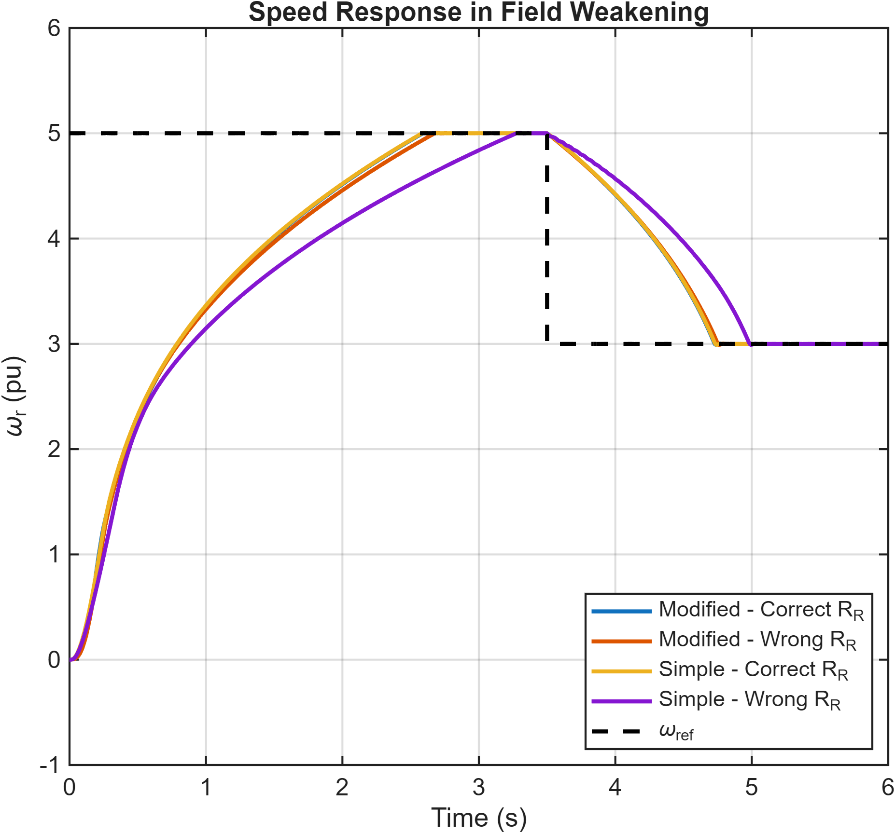

# Control of Electric Drives

Academic projects developed at the **National Technical University of Athens (NTUA)** as part of the Control Systems of Electrical Machines course.

This repository contains **dynamic machine modelling, cascaded drive control and induction-motor field-oriented control**, implemented in MATLAB and Simulink.

## Highlights

- DC motor modelling and two-degree-of-freedom PI current/speed control
- Saturation, anti-windup and disturbance-rejection studies
- Induction-motor dynamics in the stationary alpha-beta frame
- Direct-on-line startup, load characteristics and scalar V/f control
- PLL alignment, d-q current control and current-model flux estimation
- Indirect field orientation and parameter-sensitivity analysis
- Modified current-model estimation and field weakening

## Tools

- MATLAB
- Simulink

## Repository Structure

- **[exercise-1/](exercise-1/)** — DC motor modelling and control
- **[exercise-2/](exercise-2/)** — Induction-motor modelling, startup and V/f control
- **[exercise-3/](exercise-3/)** — Vector control and current-model flux estimation
- **[exercise-4/](exercise-4/)** — Improved vector control and field weakening

Each exercise includes the original models, MATLAB scripts, saved figures, the full Greek report and an English technical overview in Markdown and PDF. The English overviews are summaries, not full report translations.

## Getting Started

See [RUNNING.md](RUNNING.md) for the MATLAB/Simulink release and section-by-section workflow. Saved results can be viewed without running the models.

---

**National Technical University of Athens — 2025/2026**

Dimitris V.
