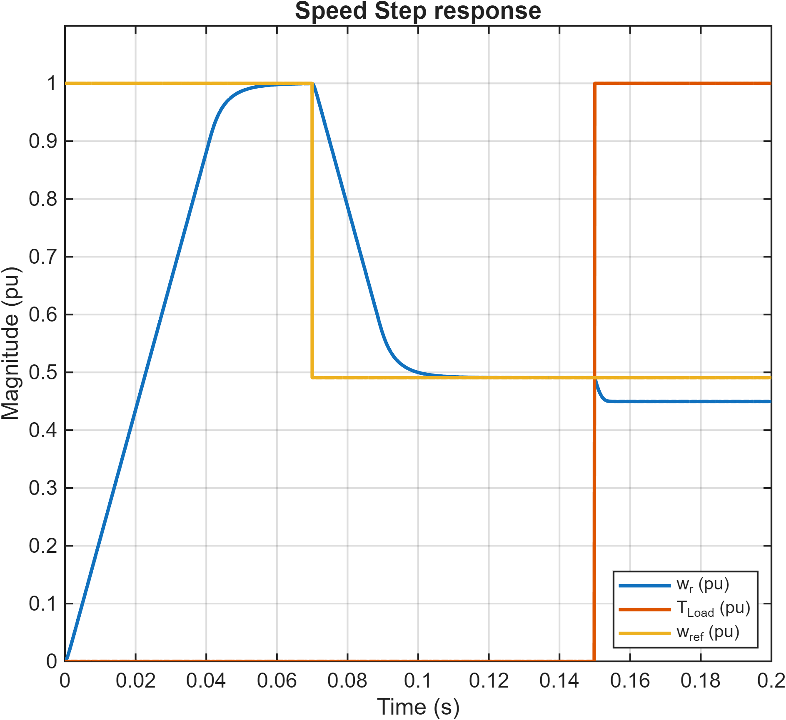
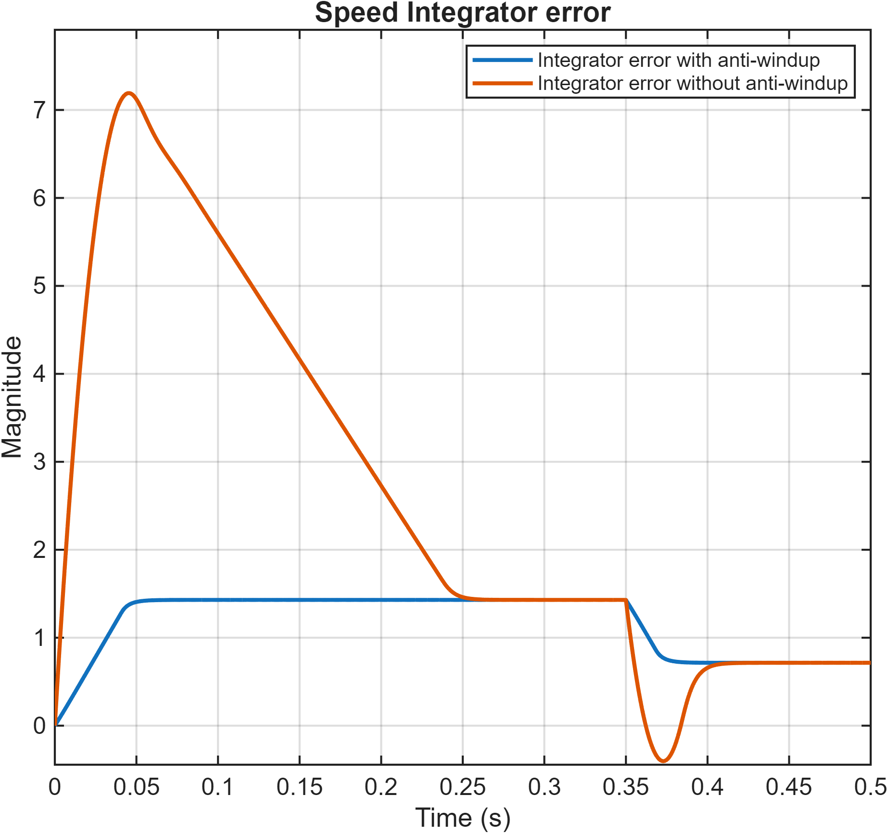

# DC Motor Modelling and Control

**English technical overview | NTUA | 2025/2026**

Dimitris Vatalas

This guide summarizes the methods and results of the accompanying Greek report. It is not a full translation. The original report contains the complete derivations, experiment settings and figure sequence. Results below are reported from that coursework; they have not been independently re-simulated for this repository.

A MATLAB/Simulink study of a DC drive, progressing from an uncontrolled machine to cascaded current and speed control with saturation and anti-windup.

## 1. Machine model

The model uses a 120 V, 20 A, 3000 rpm DC motor with nominal torque 7 Nm. Parameters include R = 0.5 ohm, L = 2.5 mH, flux linkage psi = 0.35 Vs and J = 0.001 kg m^2. The electrical and mechanical dynamics are L di/dt = v - R i - psi omega and J domega/dt = psi i - Tload - b omega.

At startup, back EMF is initially small and the uncontrolled current is large. As speed rises, back EMF reduces the effective winding voltage. The original plots show current, speed and the response to changes in load torque.

## 2. Current control

A two-degree-of-freedom PI controller includes active resistance, back-EMF feedforward, voltage saturation and back-calculation anti-windup. The target 10-90% current rise time is 1 ms, corresponding to alpha_c = ln(9)/0.001 = 2197.22 per second. The script calculates kp = alpha_c L, ki = alpha_c^2 L and Ra = alpha_c L - R.

The experiment checks current tracking and measures the rise time from the normalized response. Voltage saturation represents the available converter voltage; anti-windup prevents the integral state from growing unchecked while the requested voltage is unavailable.

## 3. Cascaded speed control

The outer speed loop produces the current reference. Its target rise time is ten times the current-loop rise time, or 10 ms. The script computes kps = alpha_s J / psi, kis = alpha_s^2 J / psi and ba = (alpha_s J - b) / psi. Current limiting and anti-windup are included in this loop as well.

Speed-reference and load steps are tested with different current limits. The recorded experiments show why the theoretical small-signal rise time is not necessarily achieved under saturation: acceleration is constrained by the available electromagnetic torque.

## 4. One-degree-of-freedom comparison

The report compares the baseline design with a reduced controller structure, both without viscous damping and with b = Tn / omega_n, approximately 0.0223 Nms. Reference changes at 0.07 s and load changes at 0.15 s test transient tracking and disturbance rejection. The saved traces show changes in overshoot, recovery and rise time as controller structure and saturation limits are changed.

These observations refer to the implemented models and finite simulation intervals. They should not be read as a general claim that a feasible, stable PI-controlled system must have a nonzero steady-state load error merely because feedforward is absent.

## 5. Anti-windup experiments

The final models disable anti-windup in the speed and current loops separately while keeping saturation. The speed experiment includes a reduction to half nominal speed at 0.35 s; the current experiment applies nominal load at 0.1 s. Integrator-state plots accompany the responses. The report records speed overshoot of about 1.1 p.u. and current overshoot above 1.3 p.u. in the respective tests without anti-windup.

## Selected project figures

## Source material

- [Complete original Greek report](report_greek.pdf)
- [Models, scripts and saved figures](models/)
