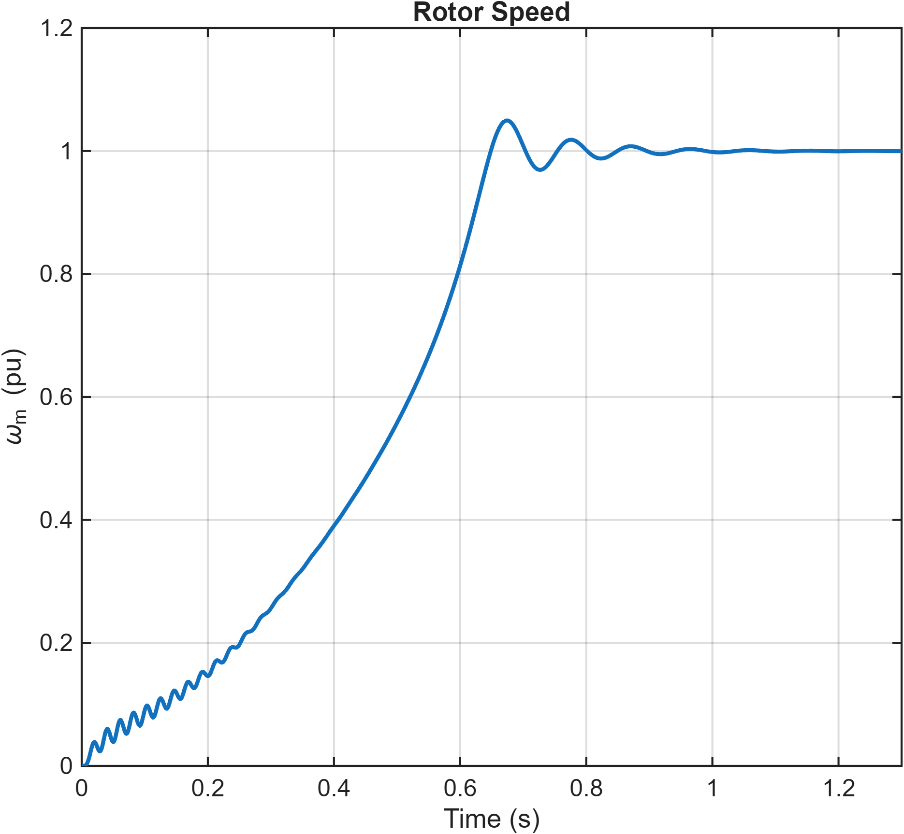

# Induction Motor Modelling and V/f Control

**English technical overview | NTUA | 2025/2026**

Dimitris Vatalas

This guide summarizes the methods and results of the accompanying Greek report. It is not a full translation. The original report contains the complete derivations, experiment settings and figure sequence. Results below are reported from that coursework; they have not been independently re-simulated for this repository.

A comparison of dynamic and quasi-steady-state induction-motor models, followed by load-dependent startup studies and scalar V/f control.

## 1. Parameters and normalization

The machine model uses 5 kW, 400 V line-to-line, 50 Hz and two pole pairs. The synchronous speed is 1500 rpm and the nominal speed 1450 rpm. The selected parameters are Rs = 1 ohm, RR = 0.45 ohm, LM = 0.20 H, leakage inductance = 0.025 H, J = 0.05 kg m^2 and b = 0.001 Nms.

The MATLAB script defines voltage, current, impedance, flux, torque and inductance bases. RMS scaling uses K = 1/sqrt(2). Care is required when comparing plots: electrical and mechanical speed, phase and line voltage, and nominal and base torque are distinct quantities.

## 2. Dynamic model

The induction machine is implemented from the inverse-Gamma equivalent circuit in the stationary alpha-beta frame. Separate real and imaginary components represent stator currents and rotor flux. The electromagnetic torque follows the cross product of rotor flux and stator current, and the mechanical equation integrates the net torque to obtain speed.

Clarke transformation blocks convert balanced three-phase supply voltages into stationary-frame components. The saved diagrams expose the machine equations and transformation implementation rather than treating the machine as an unexplained block.

## 3. Steady-state characteristics

MATLAB calculates stator-current and torque characteristics against rotor speed. The simplified curves show high startup current, a pull-out torque and a torque approaching zero near synchronous speed. In the simplified approximation the current also tends to zero; the full dynamic model retains magnetizing current. This difference matters when comparing the two model types.

## 4. Direct-on-line startup

The dynamic model starts from rest with zero external load torque. The report records strong electrical transients in current, flux and torque, while inertia smooths the speed response. As the machine approaches its final speed, stator current settles to a magnetizing-current level near 0.4 p.u.

## 5. Quasi-steady-state startup comparison

The alternative startup calculation interpolates torque and current from the steady-state characteristics and integrates the mechanical equation. It omits flux transients. Compared with the dynamic model, the recorded startup has no electrical oscillations, lower peak current and reaches equilibrium approximately 0.2 s earlier. The comparison demonstrates the limits of applying steady-state electrical assumptions during acceleration.

## 6. Speed-dependent loads

Two dynamic startup cases use load torque proportional to speed and to speed squared, normalized to the selected operating point. At low speed the quadratic load requires less torque, so acceleration is faster. The linear-load case keeps the machine in its high-current startup region longer. Flux trajectories are similar, while torque, current and acceleration differ.

## 7. Scalar V/f control

The supply-voltage magnitude follows the absolute frequency reference below base frequency and is capped above it. Reference steps pass through 0.5, 1 and approximately 0.667 p.u. with zero external load torque. The recorded response shows speed tracking with transient oscillations, approximately constant flux in the constant-V/f region and a remaining magnetizing current at steady state.

## Selected project figures

## Source material

- [Complete original Greek report](report_greek.pdf)
- [Models, scripts and saved figures](models/)
