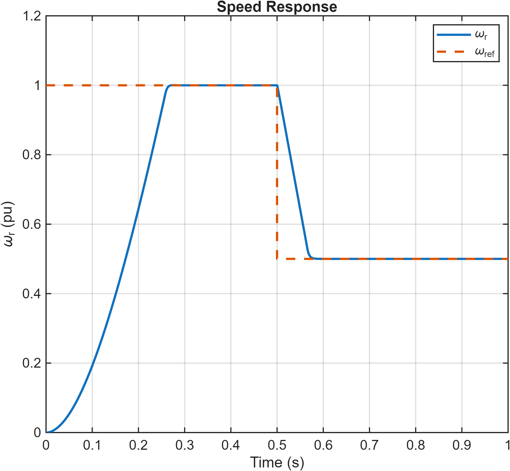

# Induction Motor Vector Control

**English technical overview | NTUA | 2025/2026**

Dimitris Vatalas

This guide summarizes the methods and results of the accompanying Greek report. It is not a full translation. The original report contains the complete derivations, experiment settings and figure sequence. Results below are reported from that coursework; they have not been independently re-simulated for this repository.

A staged implementation of rotor-flux-oriented control: PLL alignment, d-q current regulation, voltage limiting, a current-model flux estimator and an outer speed loop.

## 1. Machine and reference frame

The model uses a 2.3 kW, 230 V, 50 Hz induction machine with two pole pairs, nominal current 3.6 A, Rs = 6.5746 ohm, RR = 2.106 ohm, LM = 0.3354 H, leakage inductance = 0.0416 H and J = 0.01 kg m^2. Peak-value scaling uses K = 1.

A PLL first aligns the rotating d axis with the rotor-flux vector measured from the simulated machine. Park and inverse-Park transformations connect the stationary alpha-beta and rotating d-q frames. Successful alignment is assessed by a q-axis rotor flux close to zero. A half-nominal load step at 0.7 s checks the separation between magnetizing current id and torque-producing current iq.

## 2. Two-degree-of-freedom current control

The current controller combines PI action, active resistance, cross-coupling compensation and back-EMF feedforward. The target current rise time is 1 ms. The implementation calculates kp = alpha_c Lsigma and ki = alpha_c (Rs + RR + Ra), with Ra = alpha_c Lsigma - (Rs + RR). The script is the reference for these parameter definitions.

Current references establish nominal flux and torque. An 80%-nominal load step tests tracking. In the initial unlimited-voltage experiment, the currents track well but the requested voltages can exceed nominal limits, motivating the next stage.

## 3. Voltage-vector saturation and anti-windup

The voltage command is limited by its vector magnitude, preserving the direction of the d-q vector. Back-calculation feeds the difference between saturated and unsaturated commands to the integrators. As speed and back EMF rise, the voltage limit can prevent current tracking even when the PI controller is otherwise correctly tuned. The corresponding plots show both current and voltage responses.

## 4. Current-model flux estimation

The direct use of simulated rotor flux is replaced by an estimator based on the rotor current-model equations. Rotor flux and slip frequency determine the synchronous-frame angle. The estimated flux is compared against the actual simulated flux after transformation to d-q coordinates.

With matched parameters, the reported estimated and actual flux components agree closely. For experiments in which voltage saturation causes actual current to differ from its reference, the estimator uses measured currents. Later stages can use reference currents when the current loop tracks them adequately. This distinction is essential to interpreting the estimator tests.

## 5. Cascaded speed control

An outer two-degree-of-freedom PI loop generates iq_ref while id_ref maintains rotor flux. Its target rise time is 10 ms, ten times the current-loop target. The q-current limit accounts for the remaining current capability after allocating the d-axis component, and anti-windup protects the speed-loop integrator.

A speed step from 1 to 0.5 p.u. at 0.5 s is tested under no load. The current-limited case accelerates more slowly than the unrestricted case. The report also discusses transient flux-estimation errors and overshoot when the current limit is removed. The rotor time constant LM/RR is approximately 0.159 s, so flux dynamics cannot be treated as instantaneous during rapid changes.

## Selected project figures

## Source material

- [Complete original Greek report](report_greek.pdf)
- [Models, scripts and saved figures](models/)
