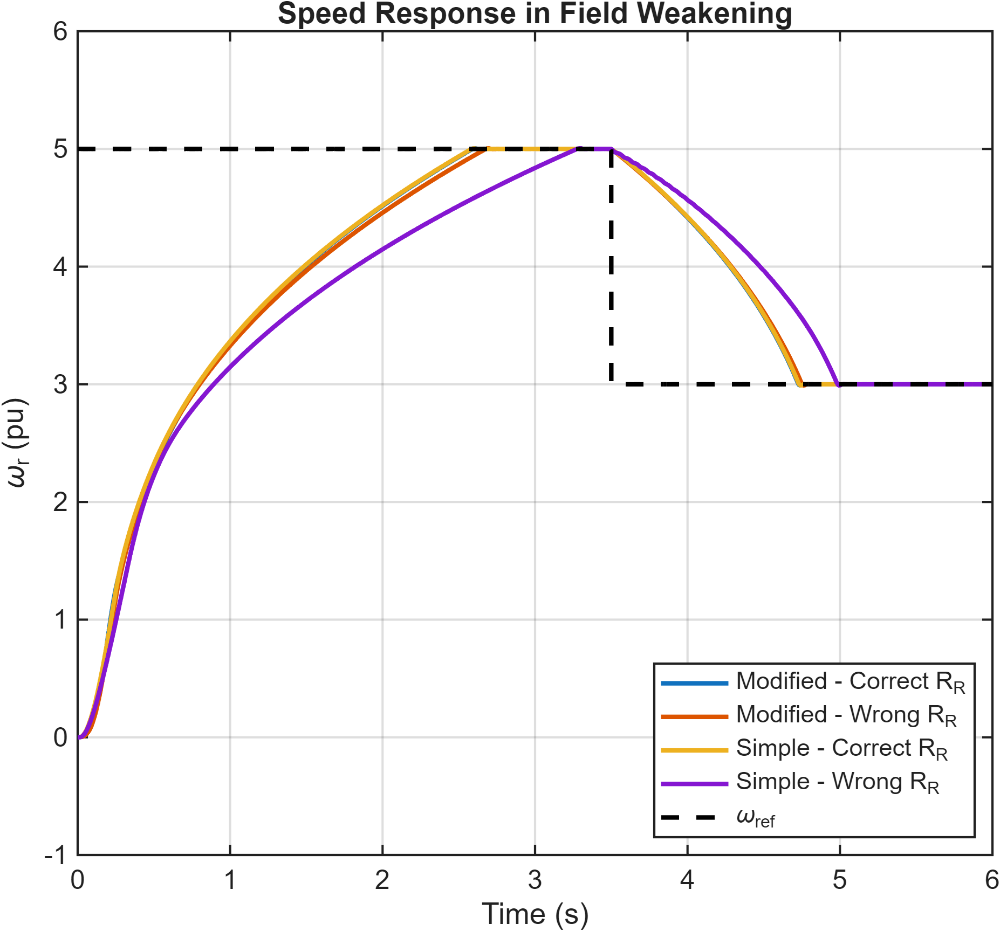
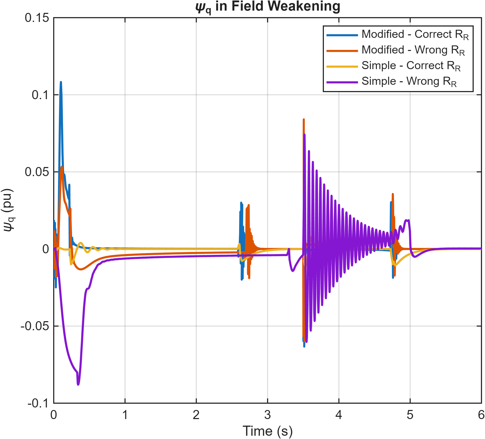

# Improved Vector Control and Field Weakening

**English technical overview | NTUA | 2025/2026**

Dimitris Vatalas

This guide summarizes the methods and results of the accompanying Greek report. It is not a full translation. The original report contains the complete derivations, experiment settings and figure sequence. Results below are reported from that coursework; they have not been independently re-simulated for this repository.

An extension of indirect field-oriented control that tests parameter sensitivity, adds a voltage-error correction to the current model and investigates high-speed field weakening.

## 1. Parameter sensitivity

The exercise builds on the preceding induction-motor drive with nominal current set to 5 A. The baseline current model estimates rotor flux and slip using rotor resistance and magnetizing inductance. Deliberate parameter mismatch is introduced and compared with the matched-parameter case.

The recorded results show that parameter errors produce nonzero q-axis rotor flux, distort the d-axis flux and slow the speed response. The torque-producing current develops larger excursions as the speed controller compensates for degraded field alignment. These experiments connect estimator errors to observable drive behavior.

## 2. Modified current model

The modified estimator adds a correction derived from the d-axis voltage error to the synchronous-frequency estimate. The correction is weighted by a speed-dependent factor with saturation. Its influence is reduced near zero speed and increases as speed rises. A filtered speed term is also used in the estimator.

The report compares nominal and deliberately incorrect parameter sets. The modified model reduces sensitivity to the tested errors and improves field alignment. It can still show transient q-axis flux deviations; improved parameter robustness does not imply that all transient errors vanish.

## 3. Field weakening

A field-weakening controller reduces the d-axis current reference when voltage capability becomes limiting. Reducing rotor flux permits operation above base speed, at the cost of reduced torque capability. The q-axis current limit is coordinated with the d-axis reference so the combined current remains within the specified limit.

The reference trajectory reaches five times base speed in the simulation. The saved plots show speed tracking, falling magnetizing current and flux above base speed, and reduced available torque. The q-axis flux remains close to zero apart from transients, indicating that field alignment is largely maintained in the studied cases. These are simulation results, not a claim of experimentally validated operation of a physical motor at that speed.

## 4. Baseline versus modified estimator

Four cases compare the baseline and modified current models, each with correct and incorrect rotor-resistance estimates, while magnetizing inductance is kept at its assumed correct value. With matched parameters, speed and torque responses are similar. Under the tested resistance error, the modified model remains close to the matched-parameter response.

The baseline estimator with the wrong resistance responds more slowly and develops pronounced flux and current oscillations during the transition from five to three times base speed. The oscillations propagate into electromagnetic torque. The comparison illustrates how an error in slip estimation affects all of the coupled control loops, especially when the available flux has already been reduced.

## Engineering outcome

The exercise demonstrates a complete progression from nominal field-oriented control to robustness evaluation and constrained high-speed operation. The source models and comparison plots make the estimator design choices and their effects inspectable.

## Selected project figures

## Source material

- [Complete original Greek report](report_greek.pdf)
- [Models, scripts and saved figures](models/)
